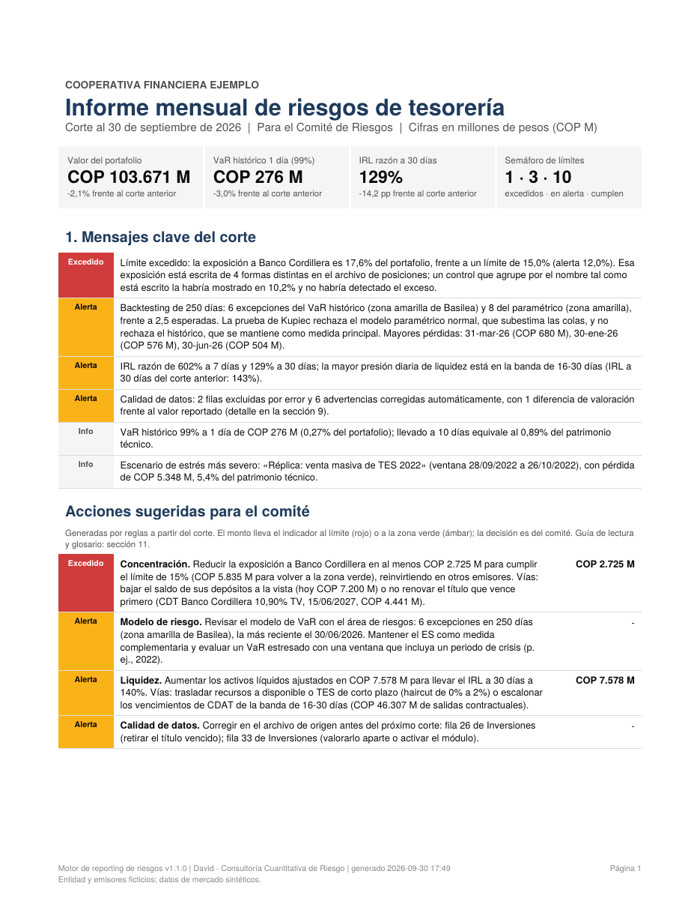
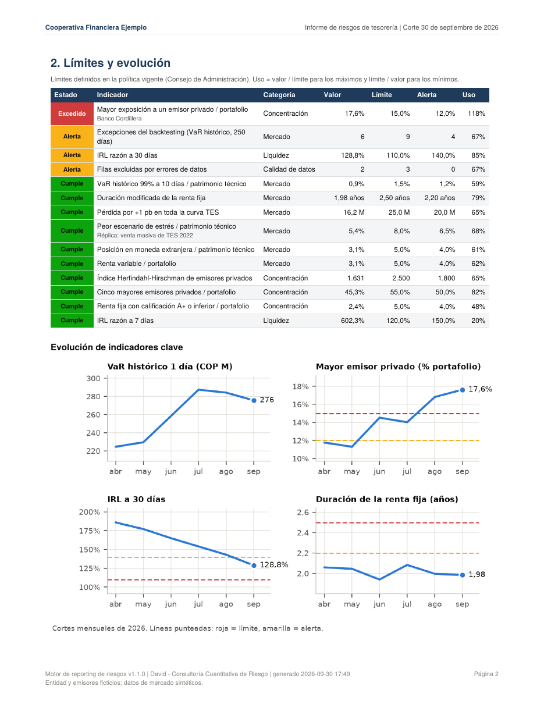

# Motor de reporting de riesgos de tesorería

> **In English:** A Python engine that turns a financial institution's monthly
> Excel of treasury positions into a 13-page risk committee report (PDF) and an
> auditable Excel annex, with no manual work: full-revaluation historical VaR and
> Expected Shortfall, EWMA parametric VaR, backtesting (Kupiec, Christoffersen,
> Basel zones), hypothetical and historical stress tests, issuer concentration with
> name reconciliation, a simplified liquidity coverage indicator, a limit traffic
> light, rule-based key messages and an action plan with amounts. Demo with a
> fictitious Colombian cooperative and synthetic market data.



Convierte el Excel mensual de posiciones de una entidad financiera en un **informe
de riesgos listo para el comité** (PDF) y un **anexo auditable** (Excel), sin
trabajo manual: VaR y Expected Shortfall, backtesting, pruebas de estrés,
concentración, liquidez (IRL), semáforo de límites y mensajes clave redactados
automáticamente.

> Esta carpeta trae una **demostración completa** con una entidad ficticia
> (*Cooperativa Financiera Ejemplo*), emisores ficticios y datos de mercado
> sintéticos calibrados a niveles aproximados del mercado colombiano 2022-2026.

---

## El antes y el después

| | Proceso manual (Excel) | Con el motor |
|---|---|---|
| Tiempo por informe | 4 a 16 horas | ~4 segundos por corte |
| Concentración por emisor | Tabla dinámica por nombre: "Banco Cordillera", "BANCO CORDILLERA S.A." y "Bco. Cordillera" cuentan como emisores distintos | Unifica los nombres contra un maestro y suma la exposición real |
| Errores de digitación | Pasan al informe sin que nadie los vea | Bitácora con hoja, fila y acción para cada hallazgo |
| VaR | Fórmula simple o ninguno | Histórico con revaluación completa + paramétrico EWMA + ES |
| Validación del modelo | No existe | Backtesting con Kupiec, Christoffersen y zonas de Basilea |
| Trazabilidad | "La versión final que Juan mandó por correo" | Huella SHA-256 de cada archivo de entrada, parámetros y versión |

**El hallazgo de la demo (corte de septiembre):** el resumen manual reporta que
todos los emisores cumplen el límite de 15%. El motor encuentra que *Banco
Cordillera* está escrito de 4 formas distintas; unificado, su exposición es
**17,6% del portafolio: límite excedido**. El control manual lo mostraba en 10,2%.

---

## Inicio rápido (Windows)

1. **Python instalado** (3.10 o superior). Si no lo tiene: python.org → Download →
   en el instalador marque **"Add python.exe to PATH"** antes de "Install Now".
2. **Descomprima** `reporting-riesgo.zip`: clic derecho sobre el archivo →
   *Extraer todo…* → en la ruta de destino escriba
   `C:\Users\SU_USUARIO\Documents\reporting-riesgo` → *Extraer*. Debe quedar
   `Documentos\reporting-riesgo\` con `instalar.bat`, `demo.bat` y las carpetas
   `riesgo`, `entrada`, etc. directamente adentro.
3. **Doble clic en `instalar.bat`** (una sola vez; tarda 2 a 5 minutos).
4. **Doble clic en `demo.bat`**: crea los datos de demostración, procesa los
   seis cortes (abril a septiembre de 2026) y abre la carpeta `salidas`.

Abra `salidas\2026-09-30\informe_riesgos_2026-09-30.pdf`.

### Alternativa por comandos

Con la terminal abierta en la carpeta del proyecto:

```
venv\Scripts\activate
python herramientas\generar_datos_demo.py
python generar_reporte.py --todos
```

Otras opciones: `python generar_reporte.py` (solo el corte más reciente),
`--corte 2026-09-30` (un corte específico), `--debug` (detalle técnico de un error).

---

## Qué se genera

```
salidas\
├── historial_indicadores.csv          evolución mensual de todos los indicadores
└── 2026-09-30\
    ├── informe_riesgos_2026-09-30.pdf  informe para el comité (13 páginas)
    ├── anexo_riesgos_2026-09-30.xlsx   detalle auditable (10 hojas, fórmulas vivas)
    └── graficas\                       las 10 gráficas en PNG
```

**Informe PDF:** 1 Resumen ejecutivo (indicadores clave, mensajes automáticos y **acciones sugeridas con montos**) ·
2 Límites y evolución · 3 Portafolio · 4 Riesgo de mercado · 5 Backtesting ·
6 Pruebas de estrés · 7 Concentración · 8 Liquidez · 9 Calidad de datos ·
10 Metodología y trazabilidad · 11 Cómo leer este informe (guía y glosario).

**Anexo Excel:** Resumen, Posiciones, Riesgo_mercado, Sensibilidades,
Backtesting, Estres, Concentracion, Liquidez, Calidad_datos, Parametros. Las
cifras de simulación van como valores; la aritmética (totales, pesos,
excepciones, cadena completa del IRL) va como fórmulas para que auditoría pueda
rastrear cada número.

---

## Estructura del proyecto

```
reporting-riesgo\
├── generar_reporte.py        el comando principal
├── instalar.bat / demo.bat / generar_informe.bat   accesos de doble clic
├── requirements.txt
├── README.md                 esta guía
├── SERVICIO.md               ficha comercial del servicio
├── entrada\
│   ├── politica_riesgo.xlsx          límites, maestro de emisores, haircuts,
│   │                                 factores de retiro y escenarios de estrés
│   ├── posiciones_AAAA-MM-DD.xlsx    un archivo por corte (lo llena la entidad)
│   └── plantilla\plantilla_posiciones.xlsx   formato vacío para un cliente nuevo
├── mercado\
│   └── factores_mercado.csv          historia diaria de curva TES, spreads, TRM, índice, IBR
├── herramientas\
│   ├── generar_datos_demo.py         crea todos los datos de la demostración
│   └── mercado_sintetico.py          el generador del mercado sintético
└── riesgo\                           el motor
    ├── config.py         parámetros técnicos (confianza, ventanas, alias de columnas)
    ├── lectura.py        lee y valida los Excel; unifica emisores; bitácora de hallazgos
    ├── mercado.py        factores de riesgo, cambios diarios, covarianza EWMA
    ├── valoracion.py     valoración por flujos con curva + spread; sensibilidades
    ├── riesgo_mercado.py VaR, ES, contribuciones, backtesting, estrés
    ├── concentracion.py  emisor, sector, calificación, plazo, HHI
    ├── liquidez.py       IRL simplificado por bandas
    ├── limites.py        indicadores y semáforo
    ├── narrativa.py      mensajes clave redactados por reglas
    ├── graficas.py       gráficas del informe
    ├── informe_pdf.py    el PDF del comité
    ├── anexo_excel.py    el anexo auditable
    └── proceso.py        orquesta un corte y guarda el historial
```

### El recorrido de un corte

1. **Lectura y validación** (`lectura.py`): encuentra la fila de encabezados en
   cualquier posición, traduce nombres de columnas, entiende números y fechas en
   formato colombiano, detecta tasas escritas en porcentaje, filas de totales,
   duplicados, títulos vencidos e instrumentos no soportados. Cada corrección
   queda registrada con su fila de Excel.
2. **Valoración** (`valoracion.py`): cada título se descompone en flujos que se
   descuentan con la curva TES del plazo más el spread de su calificación.
3. **Riesgo de mercado** (`riesgo_mercado.py`): 500 escenarios históricos
   aplicados al portafolio de hoy (VaR y ES), VaR paramétrico EWMA, backtesting
   de 250 días y escenarios de estrés.
4. **Concentración y liquidez** (`concentracion.py`, `liquidez.py`).
5. **Límites y mensajes** (`limites.py`, `narrativa.py`).
6. **Salidas** (`graficas.py`, `informe_pdf.py`, `anexo_excel.py`).

---

## Usarlo con un cliente real

1. **Su Excel de posiciones.** Opción A: la entidad llena
   `entrada\plantilla\plantilla_posiciones.xlsx`. Opción B (la usual): se
   agregan los nombres de SUS columnas como alias en
   `riesgo\config.py → COLUMNAS_INVERSIONES`; el motor ya ubica el encabezado
   donde esté. El archivo debe llamarse `posiciones_AAAA-MM-DD.xlsx`.
2. **La política** (`entrada\politica_riesgo.xlsx`): hoja *Entidad* (nombre,
   **Modo demostración = No**, borrar la nota de pie), hoja *Limites* con los
   límites aprobados, hoja *Emisores* con sus contrapartes, *Haircuts*,
   *Liquidez* (factores de retiro calibrados con la historia de la entidad) y
   *Escenarios_estres*.
3. **Datos de mercado reales** (`mercado\factores_mercado.csv`), mismo formato:

   | Columna | Contenido | Unidad | Fuente sugerida |
   |---|---|---|---|
   | fecha | día hábil | AAAA-MM-DD | |
   | TES_3M … TES_15A | curva cero cupón TES (3M, 1, 2, 3, 5, 7, 10, 15 años) | % EA | proveedor de precios de la entidad; Banco de la República (tasas cero cupón TES) |
   | SPR_AAA, SPR_AA | spread de crédito sobre TES | pb | proveedor de precios |
   | TRM | tasa representativa del mercado | COP/USD | datos.gov.co (el pipeline del proyecto cambiario) |
   | COLCAP | índice accionario local | puntos | Bolsa de Valores de Colombia |
   | IBR | IBR overnight | % EA | Banco de la República |

   Se necesitan al menos ~760 días hábiles de historia antes del corte (500 del
   VaR histórico + 250 del backtesting).
4. **Paralelo.** Durante uno o dos cortes se corre junto al proceso manual y se
   concilian las diferencias antes de reemplazarlo.
5. **Operación mensual.** Copiar el nuevo `posiciones_AAAA-MM-DD.xlsx` en
   `entrada\`, actualizar el archivo de mercado y doble clic en
   `generar_informe.bat`.

---

## Solución de problemas

| Mensaje | Qué hacer |
|---|---|
| "No se pudo abrir … ciérrelo en Excel" | Cierre ese archivo (o el PDF abierto en el lector) y repita |
| "El último dato de mercado … está N días antes del corte" | Actualice `mercado\factores_mercado.csv` |
| "No se encontraron los encabezados esperados" | Agregue los nombres de columna del cliente como alias en `config.py` |
| "Falta la hoja …" | El Excel necesita las hojas Datos_generales, Inversiones, Flujos_liquidez y Depositos_vista |
| "ERROR INESPERADO" | Repita con `python generar_reporte.py --debug` y revise el detalle |

---

## Alcance y limitaciones

- Instrumentos: TES tasa fija, CDT tasa fija, CDT IBR, bonos tasa fija, renta
  variable (vía beta al índice local), depósitos en USD y disponible/FIC. TES
  UVR, titularizaciones y derivados se reportan como error de datos (son
  módulos adicionales).
- El IRL es una **versión simplificada** e ilustrativa; antes de uso oficial se
  ajusta a la metodología exacta del supervisor de la entidad.
- El VaR a 10 días usa la regla de la raíz del tiempo (aproximación).
- El informe apoya la gestión de riesgos; no reemplaza el criterio del área de
  riesgos ni los reportes regulatorios oficiales.

Muestras: [informe completo de septiembre (PDF)](docs/muestra_informe_2026-09-30.pdf) ·


---
David, consultoría cuantitativa de riesgo (Medellín). © 2026, todos los
derechos reservados: el código se publica para consulta; su uso comercial
requiere autorización del autor. Ver también el repositorio
`diagnostico-cambiario`.
